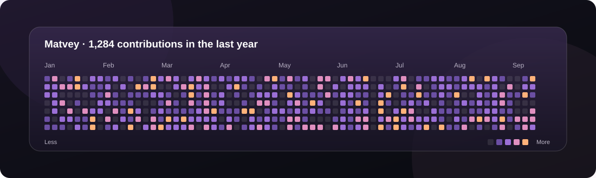

<div align="center">

# GitHub Contribution Graph

**A custom GitHub activity widget for Übersicht on macOS**


</div>

## Preview



## Features

- GitHub contribution calendar for the last year
- Purple, pink and sunset-orange contribution colors
- Translucent glass-style panel
- Drag-and-drop positioning on the desktop
- Saves the widget position between refreshes
- Refreshes every 30 minutes
- Native macOS system font

## Requirements

- macOS
- [Übersicht](https://tracesof.net/uebersicht/)
- Internet access

## Installation

1. Install and open Übersicht.
2. Open the widgets directory:

   ```text
   ~/Library/Application Support/Übersicht/widgets/
   ```

3. Create a folder named `github-graph.widget`.
4. Put `github-graph.jsx` inside it and rename the file to `index.jsx`.
5. Open `index.jsx` and set the account details near the top:

   ```js
   const USERNAME = "your-github-username";
   const DISPLAY_NAME = "Your Name";
   ```

6. Save the file. Übersicht should load the widget. If it does not, refresh widgets from the Übersicht menu.

## Customization

### Widget position

Adjust `left` and `bottom` in `className`.

### Contribution colors

Edit the `COLORS` array to change the activity palette.

### Cell size and spacing

Adjust `CELL` and `GAP`.

### Refresh interval

The default refresh interval is 30 minutes. It is controlled by `refreshFrequency`.

## Troubleshooting

- **No contribution data:** check the GitHub username and internet connection.
- **Widget does not appear:** make sure the file is named `index.jsx` and is inside a folder in the Übersicht widgets directory.
- **Data stops updating:** GitHub may have changed its page markup or temporarily limited requests.

## Credits

Made by **MaTTvey-web** for personal use with Übersicht.

---

<sub>Unofficial community widget. Not affiliated with GitHub or Übersicht.</sub>
